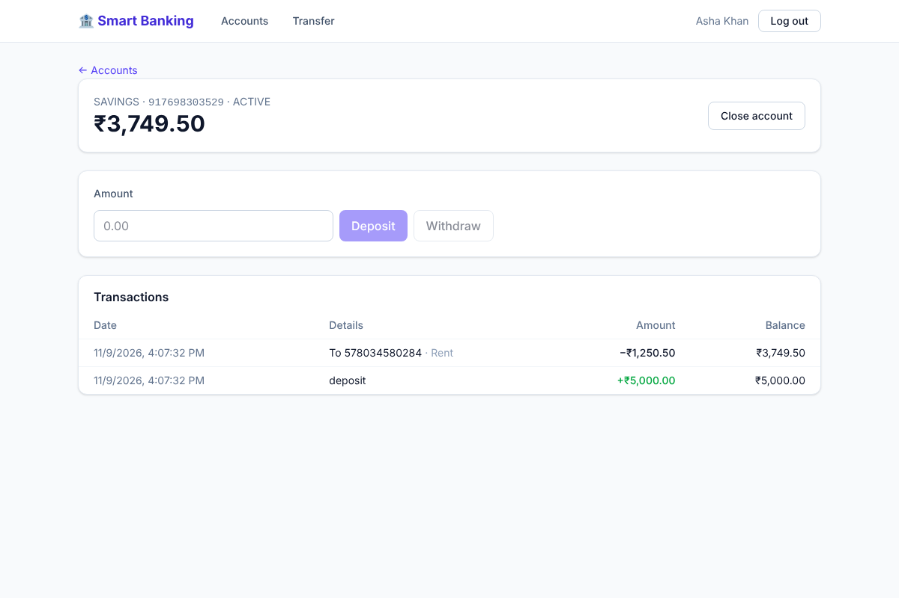
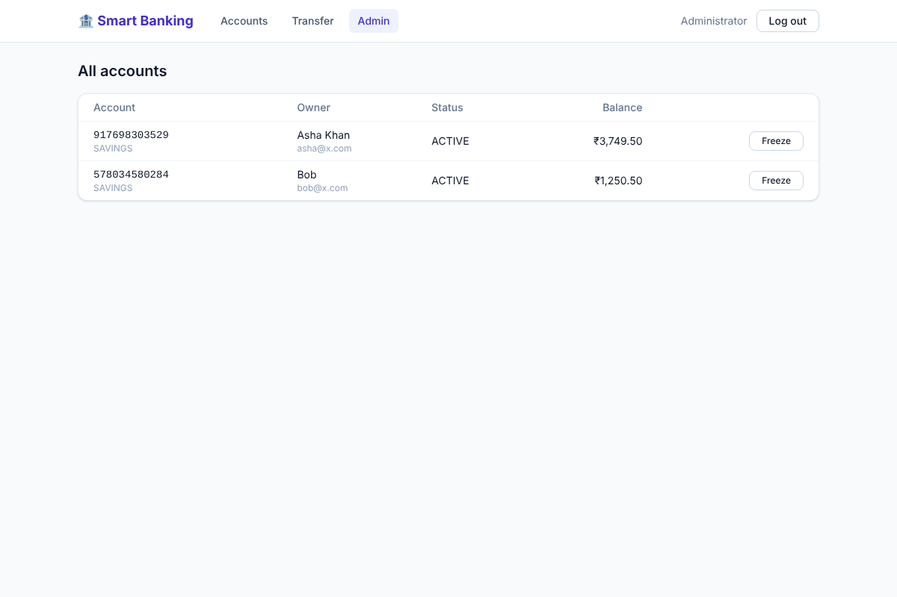

# Smart Banking


A full-stack banking app: sign up, open accounts, deposit, withdraw, send money to
other users, and see a statement with running balances. Admins can freeze accounts.

**Backend:** Java 17 · Spring Boot 3.5 · Spring Security (JWT) · JPA/Hibernate · Flyway · MySQL
**Frontend:** React 18 · Vite · Tailwind CSS
**Ops:** Docker Compose · GitHub Actions · OpenAPI/Swagger



## What makes it more than CRUD

Money code has to be correct when many requests arrive at once. This project handles that:

- **Row locking on every balance change.** Deposits, withdrawals and transfers take a
  `SELECT … FOR UPDATE` lock and re-read the balance before changing it. A test fires
  25 parallel ₹10 withdrawals at a ₹100 account and checks that exactly 10 succeed.
- **No deadlocks on transfers.** Two accounts are always locked in the same order (lower id
  first), so A→B and B→A at the same moment can't block each other. Tested with 40
  opposing transfers in parallel.
- **Optimistic locking as a backstop.** Accounts carry a `@Version` column.
- **Idempotent transfers.** The client sends an `idempotencyKey`; a retry or double click
  returns the original transfer instead of sending the money twice.
- **Exact money.** `BigDecimal` with 2 decimal places end to end; `DECIMAL(19,2)` in the
  database; amounts with more decimals are rejected, not rounded.
- **Append-only ledger.** Each transaction stores the balance after it on each side, so a
  statement can be produced without recomputing history.
- **No account probing.** Someone else's account number returns 404, not 403.

## Features

| | |
|---|---|
| Auth | Register, log in, JWT (HS256) with expiry, BCrypt passwords, roles `USER` / `ADMIN` |
| Accounts | Open savings or checking (max 5), 12-digit numbers, close when balance is zero |
| Money | Deposit, withdraw, transfer to any active account, per-transaction limit |
| Statements | Paged history per account with debit/credit, counterparty and running balance |
| Admin | List all accounts, freeze / unfreeze |
| API | Validation with field-level errors, RFC 7807 error responses, Swagger UI |

## Run it

### Everything with Docker

```bash
docker compose up --build
```

- App: http://localhost:3000
- API docs: http://localhost:8080/swagger-ui.html
- Admin login: `admin@bank.local` / `Admin12345` (change in `.env`, see `.env.example`)

### Locally without Docker

The backend uses an in-memory database by default, so it needs no setup:

```bash
cd backend
ADMIN_EMAIL=admin@bank.local ADMIN_PASSWORD=Admin12345 ./mvnw spring-boot:run
```

```bash
cd frontend
npm install
npm run dev     # http://localhost:5173, proxies /api to :8080
```

To use MySQL, set `DB_URL=jdbc:mysql://localhost:3306/smart_banking`, `DB_USERNAME` and
`DB_PASSWORD`. Flyway creates the tables on startup.

## API

| Method | Path | |
|---|---|---|
| `POST` | `/api/auth/register` | Create a user, returns a token |
| `POST` | `/api/auth/login` | Returns a token |
| `GET` | `/api/me` | Current user |
| `POST` | `/api/accounts` | Open an account `{"type": "SAVINGS"}` |
| `GET` | `/api/accounts` | My accounts |
| `GET` | `/api/accounts/{number}` | One of my accounts |
| `POST` | `/api/accounts/{number}/deposit` | `{"amount": "500.00"}` |
| `POST` | `/api/accounts/{number}/withdraw` | `{"amount": "200.00"}` |
| `POST` | `/api/accounts/{number}/close` | Close (balance must be 0) |
| `GET` | `/api/accounts/{number}/transactions?page=0&size=20` | Statement |
| `POST` | `/api/transfers` | `{"fromAccount", "toAccount", "amount", "description", "idempotencyKey"}` |
| `GET` | `/api/admin/accounts` | Admin: all accounts |
| `PATCH` | `/api/admin/accounts/{number}/status` | Admin: `{"status": "FROZEN"}` |

Errors look like this:

```json
{ "status": 422, "title": "Unprocessable Entity", "detail": "Insufficient funds in account 301945437584" }
```

## Tests

```bash
cd backend && ./mvnw test
```

18 integration tests run against the real Spring context and database layer: auth,
validation, deposits, overdraft protection, transfers and statements, access control,
idempotency, account closing, admin freeze, and the two concurrency tests above.
CI runs them plus the frontend build and Docker build on every push.

## Project layout

```
backend/src/main/java/com/bank/management_system/
  auth/          register, login, JWT issuing
  account/       accounts: open, list, close
  transaction/   deposit, withdraw, transfer, statements
  admin/         admin endpoints
  config/        security, OpenAPI, admin seeding
  common/        errors and money helpers
backend/src/main/resources/db/migration/   Flyway SQL
frontend/src/    React pages and API client
```


